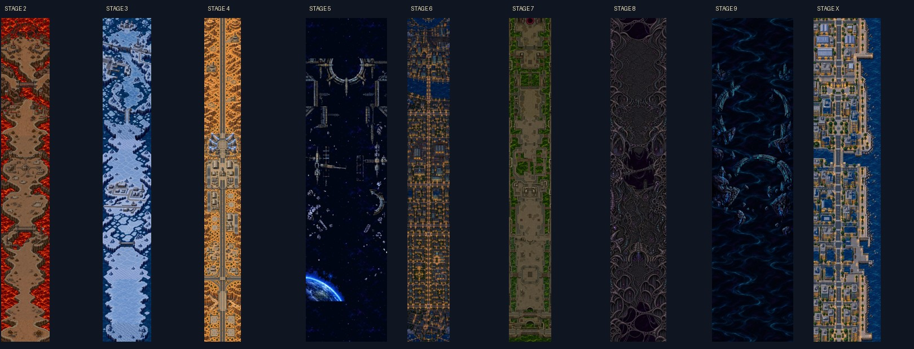
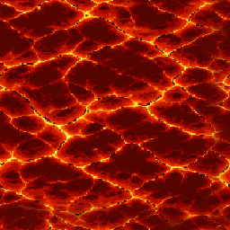

# Bullets of Fury — layered level concepts

November 2, 2026. Review art only. **No game files are replaced or imported.**

Mike approved the Stage 2–9 and X directions, rejected the proposed Stage 1 jungle, and requested separate liquid layers, passive Stage 5 scenery and longer connected sections. This pack contains those revisions plus the approved story concepts.



Open the interactive layer viewer by serving this directory locally:

```powershell
python -m http.server 8820 --directory docs/level_concepts_1102
```

Then open `http://127.0.0.1:8820/`. The viewer can hide the bed, show terrain transparency, scrub through the expanded routes, play their forward cycles and preview the independent material clock. It is a standalone art viewer, with no game scripts or game state.

## Approved direction and revisions

| Stage | Terrain and section additions | Independent lower layer |
| --- | --- | --- |
| 1 | Jungle proposal excluded. Current game untouched. | — |
| 2 | Basalt necks, geothermal yard, lava-gorge bridge, relay plateaus and extra volcanic connector | Flat animated lava |
| 3 | Snow depot, rail/bridge approaches, broken ice and extra lake connector | Water |
| 4 | Alternating airbase/pad sides, giant central airbase, six-tower electric launchpad, new rock-lined highway chase | Opaque desert; separate highway cycle |
| 5 | Orbital structures, asteroids and Earth limb exported as **passive background scenery** | Space bed |
| 6 | Lit city districts, rail yard, civic/residential sections, river bridges and inland connector | Dark water |
| 7 | Maintenance sections, pump infrastructure, open basins and industrial connector | Toxic fluid |
| 8 | Living biomechanical floor, cable bridges and additional organic chasm district | Dark violet biofluid |
| 9 | Distant cosmic fragments and separated currents | Cosmic water/void bed |
| X | Coastal city, streets, bridges, seawalls and extra waterfront district | Water |

The Stage X building damage sheet remains a proposal for player/allied destructibility. Stage 5 objects have `collision: false`, `targetable: false` and passive-background status in the manifest. These flags describe the concepts; they do not change runtime behavior. The electric pad preview uses the actual exported Storm Sovereign.

## Coverage and connections

Routes use one proportional scale at a common **680-pixel width**. Each route also has exact 680 × 680 slices; the last slice uses transparent padding and records its valid height. Do not stretch individual sections to fit.

| Stage | Current scenery baseline | New route height | Continuation |
| --- | ---: | ---: | --- |
| 2 | 4,080 | 4,568 | Finite, longer |
| 3 | 4,080 | 4,568 | Finite, longer |
| 4 | 4,080 | 5,992 | Main route plus separate highway loop |
| 5 | 2,720 | 2,720 | Passive background cycle; unbounded |
| 6 | 5,000 | 5,248 | Forward city cycle; unbounded |
| 7 | 4,716 | 5,248 | Finite, longer |
| 8 | 1,536 source period | 3,952 | Forward organic cycle; unbounded |
| 9 | 2,720 source period | 2,720 | Background cycle; unbounded |
| X | 1,536 source period | 3,272 | Forward waterfront cycle; unbounded |

These are **scenery capacity comparisons**, not new gameplay durations. Stage 4's native 3,568-pixel travel plus its 512-pixel viewport gives its 4,080 baseline. Stages 5, 8 and 9 already repeat in the current runtime; the new cycles can likewise cover an arbitrary travel distance. No stage timers or encounter schedules were edited. The measured runtime configuration is preserved in [native-lengths.json](provenance/native-lengths.json).

Internal transitions use generated connector art and source-pixel quilting cuts, without crossfading buildings or stretching roads. Their locations are recorded in [manifest.json](manifest.json). **They are visual review candidates**, with terrain/collision authoring and final join polish reserved for an approved integration pass.

The repeating Stage 6/8/X routes and Stage 4 highway place their wrap boundary inside an intact source section, so the last and first rows are consecutive source rows. Stage 5/9 cycles wrap through fully transparent space. The viewer repeats northward; it never flips a city district vertically. The Stage 4 highway is a separate file so the launchpad/base sequence does not recur during the chase.

## Separate material beds



- Lava: 8 generated frames, **256 × 256**, 8 fps; [4 × 2 sheet](liquids/lava/sheet.png), individual PNG frames and GIF.
- Water, dark water, toxic fluid, biofluid, cosmic currents and space: separate **512 × 512** flat tiles.
- Opposite tile edge pixels match. Material-only exports use edge feathering; terrain and buildings do not.
- Lava animation uses a fixed canvas and shared palette. All frames decode separately; no shoreline or buildings are baked into the liquid.

Transparent terrain reveals these beds. The viewer moves the bed with its own clock even when terrain scrolling is paused. The still tiles are supplied as insertable layers; only lava has an authored frame bank in this pack. Future water/toxic animation banks can be approved separately.

## Story images

The eight approved environmental plates and two Cole composites are in [cutscenes/](cutscenes/). Story progression follows the existing campaign: surface relays → power cell → orbital relay/Chronos → city invasion → underground signal → Dracodia. Stage 9 remains the optional cosmic branch and Stage X the optional coastal rival branch. The ending retains the next-alarm cliffhanger.

The Cole composites use actual exported in-game aircraft pixels. The art is for review; no native cutscene owner, dialogue or timing is replaced. Liquids in these cinematic environment paintings remain part of the approved paintings; the layer separation above applies to playable scenery.

## Files and provenance

- `terrain/`: alpha terrain and new connector/extension pieces.
- `routes/`: assembled routes, exact section slices and separate Stage 4 highway cycle.
- `liquids/`: independent flat material tiles and lava animation.
- `sources/`: unchanged approved source art, raw new generations and AI extraction mattes. Raw sources retain original dimensions; delivered terrain/cells use even dimensions. Mattes are semantic guides, not game art.
- `cutscenes/`, `extras/`: approved story art, launchpad preview and building damage study.
- `previews/`: flattened review images only; use the separate terrain/material exports for later integration.
- `provenance/`: prompts, source dimensions, extraction notes, runtime measurements and verification report.

Approved terrain RGB was retained during alpha extraction. Generated RGBA connector exports use a fixed alpha cutoff to remove faint fringe. Raw originals remain available. No production atlas, manifest, encounter or game file is registered by this pack.
